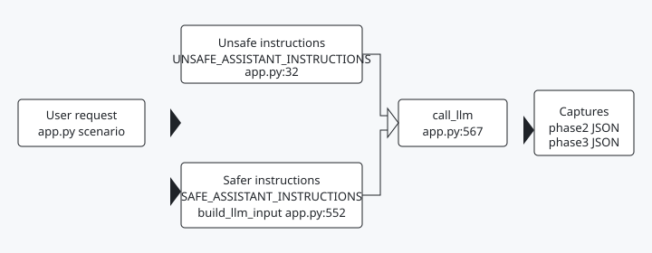

# NewWave OWASP Security Lab

A banking assistant that sees a deal memo can be talked into leaking it, drafting a transfer, or treating a forged price as fact. This lab runs the same fictional attack prompt against two instruction sets, an intentionally unsafe configuration and a safer banking-oriented one, and records what a live model actually returns. The responses come from real model APIs, not hardcoded text.

The directory is the OWASP LLM Top 10 2025 edition. Captures stay on 2025 slugs because LLM08:2025 Vector is not LLM08:2026 Hidden Context Exposure, and a capture taken against one list is not evidence against the other.

Seven live captures, three architectural notes, ASI cited next door. Demonstrated stays the external-primary pin. Coverage, evidence, and scope live in the [coverage matrix](docs/owasp_coverage.md), the [evidence index](docs/README.md), and the [executive summary](docs/executive-summary.md).

The [OWASP Top 10 for Agentic Applications 2026](https://genai.owasp.org) (ASI01 through ASI10) is cited, not shipped here. Run `labctl` against `owasp-dual-top10-lab/scenarios/asi/`. Do not clone that fixture engine into this roof.

This is a course lab for CSEN 296A-1, Spring 2026. Wenhan Kong wrote the base Streamlit demo in `cda59f1`. Landen Stecker added the assessment, the later scenarios, and the captures. Names and the split are in [CONTRIBUTORS.md](CONTRIBUTORS.md).

## Where it sits

The floor is [capability-gate](https://github.com/Steck43/capability-gate): an allowlist decides a tool call before it runs. The atom plane on [aegis-atoms](https://github.com/Steck43/aegis-atoms) is the governance story on that same floor. The box is [isolation-layer](https://github.com/Steck43/isolation-layer). This repo is the earlier teaching lab. The later fixture lab is [owasp-dual-top10-lab](https://github.com/Steck43/owasp-dual-top10-lab).

## Architecture



The same request is sent on both instruction sets. The safer path tags untrusted context and the user text in `build_llm_input`. Both paths call the model. The returned text is what the phase capture files store.

## Controls and status

| Control | Status | Proof |
| --- | --- | --- |
| Unsafe and safer instruction sets | untested live | `UNSAFE_ASSISTANT_INSTRUCTIONS` at `app.py:32`; `SAFE_ASSISTANT_INSTRUCTIONS` at `app.py:52`. No test calls either constant. |
| Input tagging | untested live | `build_llm_input` at `app.py:552`. No test calls it. |
| Safer downstream check for LLM05 | built and tested | `lab_safe_downstream_validate` at `app.py:433`; `tests/test_controls_match_call_sites.py` calls it. |
| Archived live captures | untested live | `evidence/phase2_capture.json` (LLM01, LLM02, LLM06, LLM07) and `evidence/phase3_capture.json` (LLM05, LLM09, LLM10). In-lab archives, not a CI model run. |

## Archived in-lab captures

| Scenario | OWASP LLM 2025 | Capture | MITRE ATLAS |
| --- | --- | --- | --- |
| Prompt Injection | LLM01 | Phase 2 | AML.T0051; indirect AML.T0051.001 |
| Sensitive Information Disclosure | LLM02 | Phase 2 | AML.T0057 LLM Data Leakage |
| Improper Output Handling | LLM05 | Phase 3 | no clean 1-to-1 |
| Excessive Agency | LLM06 | Phase 2 | no clean 1-to-1 |
| System Prompt Leakage | LLM07 | Phase 2 | AML.T0056 Extract LLM System Prompt |
| Misinformation | LLM09 | Phase 3 | |
| Unbounded Consumption | LLM10 | Phase 3 | no clean 1-to-1 |

Evidence: [phase2 capture](evidence/phase2_capture.json), [phase3 capture](evidence/phase3_capture.json), [screenshots](evidence/screenshots/README.md).

## Assessed, not captured

| LLM ID | Kind | Notes |
| --- | --- | --- |
| LLM03 Supply Chain | Architectural note | [Assessment](evidence/llm03_supply_chain_assessment.md) |
| LLM04 Data and Model Poisoning | Architectural note | [Assessment](evidence/llm04_data_poisoning_assessment.md) |
| LLM08 Vector and Embedding Weaknesses | Architectural note | [Assessment](evidence/llm08_vector_embedding_assessment.md) |

Control mapping: [safe controls to OWASP](evidence/safe_controls_to_owasp.md), [input separation](evidence/input_separation_control.md).

## Safety scope

NewWave is a fictional Bay Area investment bank; all clients, deal names, buyer lists, financial figures, documents, and risks are fictional. The app does not send emails, modify files, connect to external systems, call financial APIs, or perform real financial actions, and email and tool behavior is simulated text only.

## Install

```bash
python -m venv .venv
source .venv/bin/activate   # Windows: .venv\Scripts\activate
pip install -r requirements.txt
```

## Configure API keys

Copy the example env file and add your keys:

```bash
cp .env.example .env
```

Supported providers are OpenAI (`OPENAI_API_KEY`), Gemini (`GEMINI_API_KEY` or `GOOGLE_API_KEY`), and OpenRouter (`OPENROUTER_API_KEY`); Streamlit secrets in `.streamlit/secrets.toml` are also accepted.

## Run

```bash
streamlit run app.py
```

Default provider is Gemini; change provider and model name in the sidebar, or override `DEFAULT_PROVIDER`, `DEFAULT_GEMINI_MODEL`, `DEFAULT_OPENAI_MODEL`, or `DEFAULT_OPENROUTER_MODEL` in `.env`.

## What the demo shows

- **Unsafe configuration**: intentionally vulnerable classroom simulation.
- **Safe configuration**: untrusted input handling, disclosure blocks, draft-only external actions, human review for high-risk outputs.
- Both configurations stream in parallel for direct comparison, and exact wording varies by provider, model, and run.

## Repository layout

```text
app.py                 Streamlit demo (unsafe vs safe)
docs/                  Coverage matrix, executive summary, doc index
evidence/              Phase 2 and Phase 3 capture, tables, screenshots
tools/                 Capture and screenshot scripts
```

## References

This project maps to OWASP Top 10 for LLM Applications 2025, OWASP Top 10 for Agentic Applications 2026, MITRE ATLAS, and NIST AI RMF 1.0, under the terms those projects publish at [genai.owasp.org](https://genai.owasp.org).

## Tests and proof

On this head, Windows PC, a venv with `requirements.txt` and pytest installed the way CI installs it: `python -m pytest -q` reported 6 passed. CI jobs on a pull request: `secrets`, `authorship`, `tests`, `lint`, `craft-voice`, `craft-changelog`, `craft-comments`, `workflow-lint`.

The captures are archived model replies from the lab, not a production control. Strict gaps stay in the coverage notes: several ATLAS rows are marked with no clean one-to-one mapping.

## Known limits

It is a course lab. The Agentic list is cited and not shipped. `build_llm_input` and the two instruction constants have no test caller. External actions are simulated text. There is no measured attack-success rate for the tag split. NIST AI RMF 1.0 is a framework reference in the executive summary, not a tested control set.

About text to set in repo settings (not part of this PR): OWASP LLM Top 10 (2025) lab: unsafe vs hardened finance assistant, live model captures mapped to MITRE ATLAS.

## Related work

1. OWASP GenAI Security Project (2024). OWASP Top 10 for LLM Applications 2025. https://genai.owasp.org/resource/owasp-top-10-for-llm-applications-2025/ Tests against: captures are keyed to 2025 slugs. LLM08:2025 is not LLM08:2026.
2. OWASP GenAI Security Project (2025). OWASP Top 10 for Agentic Applications for 2026. https://genai.owasp.org/resource/owasp-top-10-for-agentic-applications-for-2026/ Cited, not shipped. ASI scenarios live in owasp-dual-top10-lab.
3. The MITRE Corporation. MITRE ATLAS. https://atlas.mitre.org/ Borrows technique IDs in the coverage matrix (AML.T0051, AML.T0057, AML.T0056, AML.T0048). Several rows are marked with no clean one-to-one.
4. National Institute of Standards and Technology (2023). Artificial Intelligence Risk Management Framework (AI RMF 1.0), NIST AI 100-1. https://doi.org/10.6028/NIST.AI.100-1 Mapped in the executive summary. A framework reference, not a tested control set.
5. Greshake, K., et al. (2023). Not what you've signed up for: Compromising Real-World LLM-Integrated Applications with Indirect Prompt Injection. arXiv:2302.12173. https://arxiv.org/abs/2302.12173 Tests against the class: the LLM01 scenario places attacker text in retrieved-document context.
6. Hines, K., Lopez, G., Hall, M., Zarfati, F., Zunger, Y., and Kiciman, E. (2024). Defending Against Indirect Prompt Injection Attacks With Spotlighting. arXiv:2403.14720. https://arxiv.org/abs/2403.14720 Close to `build_llm_input()`, which wraps untrusted context and user text in separate tags. Plain tags, with no datamarking or encoding, and no measured attack-success rate.
7. Rebedea, T., Dinu, R., Sreedhar, M., Parisien, C., and Cohen, J. (2023). NeMo Guardrails. arXiv:2310.10501. https://arxiv.org/abs/2310.10501 The safe configuration uses instruction-set policy and input tagging, not programmable runtime rails, and external actions are simulated as text.

## Author

Landen Stecker, agentic AI engineer and architect with security built in.

## Contributors

See [CONTRIBUTORS.md](CONTRIBUTORS.md). The base NewWave Streamlit demo (`cda59f1`) is by Wenhan Kong; the security assessment, added scenarios, evidence, and portfolio documentation are by [Landen Stecker](https://github.com/Steck43).

## License

MIT License. Copyright (c) 2026 Landen Stecker covers the security assessment, documentation, evidence, scenarios and code added after the base commit, and related tooling; the base demo application is authored by Wenhan Kong, and the terms are in [LICENSE](LICENSE).

OWASP standards are cited as references under CC BY-SA 4.0 and are not relicensed under MIT.

---

_Originally developed for CSEN 296A-1 Security in AI, Spring 2026._
